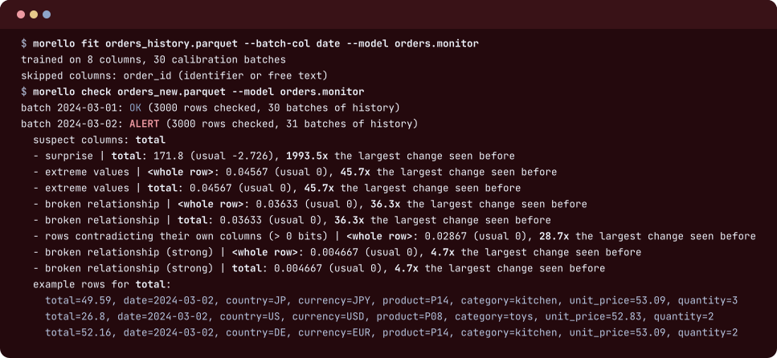

<p></p>

# Morello

Morello flags batches of a table whose rows stop making sense together: records joined to the
wrong record, swapped columns, changed units, remapped codes, lost precision. It also runs basic
per-column checks (nulls, unexpected values, distribution shift, duplicates).

It needs no rules. You give it a history of the table that you believe is clean, and then each
new batch.

<p></p>

The session above is real output on a synthetic orders table. On the second new day, 5% of
orders carry another order's product, category and unit price. Every column of those rows looks
normal on its own. Morello alerts because `total` no longer equals `unit_price` times
`quantity`, names the column, and prints rows to look at. To reproduce it:

    python examples/make_orders.py
    morello fit   orders_history.parquet --batch-col date --model orders.monitor
    morello check orders_new.parquet     --model orders.monitor

## Contents

- [Install](#install)
- [Use from Python](#use-from-python)
- [Use on a table in a warehouse](#use-on-a-table-in-a-warehouse)
- [Use from the command line](#use-from-the-command-line)
- [Where it runs](#where-it-runs)
- [Evidence so far](#evidence-so-far)
- [How it works](#how-it-works)
- [Settings](#settings)
- [Limits](#limits)
- [Design](#design)
- [Development](#development)
- [Files](#files)

## Install

    pip install .            # from this folder; needs Python 3.10+, numpy, pandas, lightgbm, pyarrow

## Use from Python

```python
import pandas as pd
from morello import Monitor

# At least 20 batches of history. About 50 are needed for alerts to be on from day one.
history = pd.read_parquet("orders_history.parquet")
monitor = Monitor().fit(history, batch_col="order_date")  # daily batches by default
monitor.save("orders.monitor")

report = monitor.check(pd.read_parquet("orders_today.parquet"))
print(report.text())
if report.alert:
    ...  # stop the pipeline, page someone
    # monitor.accept(report)      # if a person decides the batch was fine
monitor.save("orders.monitor", history_only=True)  # the history grows with every clean batch
```

## Use on a table in a warehouse

```python
from morello.table import fit_table, check_table

fit_table(conn, "analytics.orders", batch_col="order_ts", store="s3://bucket/morello")
reports = check_table(
    conn, "s3://bucket/morello", table="analytics.orders", results_table="ops.morello_results"
)
```

The sample is taken by a query inside the warehouse, so table size does not matter. `conn` can be
DuckDB, Spark, Snowpark, a SQLAlchemy URL or a DB-API connection. Adapters for Spark and Databricks,
Snowflake, dbt, Airflow, Dagster and Scala jobs are described in [`docs/integrations.md`](docs/integrations.md), together with
which of them have actually been run.

## Use from the command line

    morello fit   orders_history.parquet --batch-col order_date --model orders.monitor
    morello check orders_today.parquet   --model orders.monitor --json report.json

Exit codes: 0 when nothing alerts, 1 when a batch alerts, 2 when the command could not run. A
pipeline step can therefore gate on `check`. CSV files work too.

Reports are coloured when they are printed to a terminal: `ALERT` in red, `OK` in cyan, column
names in bold. The colours only repeat what the words say. `--color never` or the `NO_COLOR`
environment variable turns them off, and `--color always` keeps them when output is piped.

## Where it runs

| piece | status |
|---|---|
| pandas DataFrames, parquet files, command line | tested |
| In-warehouse sampling, table runner, results table, per-slice checks | tested on DuckDB, including 13.8 million raw taxi rows |
| Spark adapter, including scoring on executors | tested on a local Spark session |
| dbt Python model and `morello_ok` test | tested with dbt-duckdb |
| Snowflake stored procedure and SQL dialect | written, not run against Snowflake |
| Databricks | same code as the Spark test, not run on Databricks |
| dbt on Snowflake, Databricks or BigQuery | same model file, not run on those platforms |
| Airflow operator, Dagster asset check | written, not run inside those schedulers |
| Scala | no native API; Scala jobs gate on the results table |

Setup for each platform is in [`docs/integrations.md`](docs/integrations.md).

## Evidence so far

All failures are simulated. Ten failure types at four severities (1%, 5%, 25% and 100% of rows)
were injected into every day of May 2024, a month that was not used to design or tune anything.
The table shows the share of injected failures detected, with the number of clean days that
alerted in brackets.

| data | standard per-column checks | Morello's row model alone | both (what this package runs) |
|---|---|---|---|
| NYC taxi trips | 0.51 (2/31) | 0.64 (3/31) | 0.77 (3/31) |
| NYC EMS dispatch | 0.69 (2/31) | 0.58 (2/31) | 0.78 (3/31) |

Records joined to the wrong record are where the row model matters most. On taxi data it caught
them on every day at every severity, against 0.06 for standard checks. NannyML's PCA
reconstruction, run on the same batches, detected 0.19 of failures on taxi and 0.34 on EMS.

Morello has not been tested on real incidents or against commercial tools, and it was weak on a
table with few rows per batch. The full tables and method are in [`docs/results.md`](docs/results.md).

## How it works

1. **Columns.** Numbers, booleans, text categories and timestamps are handled automatically.
   Timestamps become hour-of-day plus the gap to the first timestamp column. Identifier and
   free-text columns are skipped and listed in `monitor.schema.skipped`.
2. **Model.** Each column is predicted from the columns before it (gradient-boosted trees). The
   model gives every value a probability given the rest of its row.
3. **Checks per batch.**
   - *surprise*: how much less predictable a column was than the model expected.
   - *broken relationship*: share of values far less likely given their row than on their own.
   - *extreme values*: share of values the model considered nearly impossible.
   - *digit pattern*: change in the last digits of numeric columns (rounding, unit changes).
   - per-column null rate, unexpected values, distribution shift, mean, spread, duplicates.
4. **Alert rule.** Each check is compared with its median over the last 28 batches (weekdays and
   weekends separately). It alerts when the change is more than `margin` (default 3) times the
   largest change seen on any earlier clean batch. Clean batches are added to the history
   automatically; alerting batches are added only if you call `accept`.

`fit` trains the model on the earliest half of the history and uses the later half to learn how
much each check normally moves. Alerts switch on after 14 calibrated batches
(`monitor.batches_until_ready`).

## Settings

| argument | default | meaning |
|---|---|---|
| `margin` | 3.0 | higher means fewer alerts |
| `window` | 28 | batches that define "usual" |
| `sample_rows` | 5000 | rows scored per batch |
| `max_train_rows` | 150000 | rows used to train the model |

## Limits

- Needs volume. With a few hundred rows per batch, or rows that come in clusters from few
  entities, normal variation hides most problems.
- Does not catch duplicated rows through the model (a separate duplicate check is included)
  and is weak on a missing slice of the data.
- Real changes in the source (a holiday, a fee change) alert too. Expect a few alerts a month
  on a busy table; `accept` teaches the monitor the new normal.
- The model should be refitted when the table's meaning changes, or every few months.
- Saved monitors are compressed JSON (no pickle), split into a model part and a small history part.
- One job at a time should check a given table. Saved state is not locked.
- Evidence so far is from simulated failures on three public datasets. See [`docs/results.md`](docs/results.md).

## Design

[`docs/design.md`](docs/design.md) explains how the code is organized and what happens when a
run fails part-way. In short:

- A run can be repeated. The history keeps one entry per batch, and a run that dies starts
  again from the same batch.
- Saved state is never half-written, and a history is only ever loaded with the model it
  belongs to.
- The cost of a check depends on the sample size, not on the size of the table.
- Statistics add up across chunks of a batch, so a batch can be scored on many machines.

## Development

    pip install -e ".[dev]"
    ruff check . && ruff format --check .
    pytest                     # the Spark test is skipped when pyspark is not installed

## Files

    morello/             the package; docs/design.md describes each module
    tests/               unit tests, plus end-to-end tests on DuckDB and local Spark
    examples/            demo.py and make_orders.py (synthetic orders), dbt/ project, scala/ gate
    docs/                design.md, integrations.md, results.md
    research/            the experiment scripts and result files behind docs/results.md
    assets/brand/        logo, colours, type, slide template (see BRAND.md)
    site/                landing page, published at zulnoraina.com/morello/
    wrangler.jsonc       Cloudflare settings that publish site/
